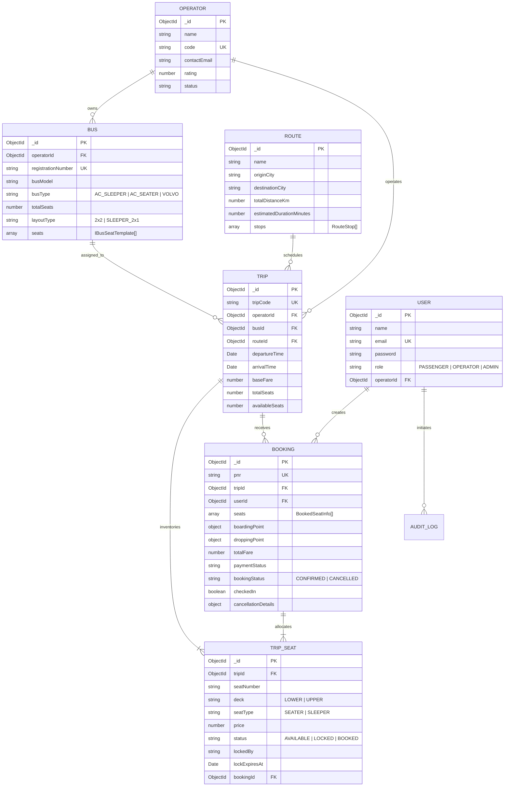

# OmniBus: Enterprise Bus Booking & Fleet Management Platform

[](https://github.com)
[](https://www.typescriptlang.org/)
[](https://tailwindcss.com/)
[](https://vitest.dev/)
[](http://localhost:5000/api-docs)

> **OmniBus** is a production-grade full-stack web application supporting the complete lifecycle of a multi-operator intercity bus transport business. It features **atomic seat reservation & concurrency protection**, **server-side RBAC**, **verifiable PNR ticketing**, **dynamic tiered cancellation & simulated refunds**, **operator manifests with real-time boarding check-in**, and an **immutable business audit trail**.

---

## 1. Acceptance Tests Demonstration

The system was engineered to satisfy all five core evaluation acceptance criteria:

| # | Acceptance Criteria | Engineering Implementation | Test Evidence |
| :- | :--- | :--- | :--- |
| **AC-1** | **Search Valid Trip & Book Seat** | Search engine API (`/api/trips/search`), interactive 2D seat map with deck switching, atomic booking creation with instant PNR. | [`test/booking.integration.test.ts`](file:///c:/Users/HP/OneDrive/Desktop/offcampus/f2p/server/test/booking.integration.test.ts) |
| **AC-2** | **Seat Concurrency & Conflict Prevention** | Two simultaneous requests attempting to confirm the exact same seat cannot both succeed. Compound unique index (`{ tripId: 1, seatNumber: 1 }`) + atomic compare-and-swap update. Exactly one confirms (`201`); the second is rejected (`409 Conflict`). | [`test/concurrency.conflict.test.ts`](file:///c:/Users/HP/OneDrive/Desktop/offcampus/f2p/server/test/concurrency.conflict.test.ts) |
| **AC-3** | **PNR Ticket Integrity** | Unique alphanumeric PNR (`BUS-XXXXXX`) generated per booking containing passenger name, age, gender, route, timings, seat numbers, fare, and QR verification data. | [`test/booking.integration.test.ts`](file:///c:/Users/HP/OneDrive/Desktop/offcampus/f2p/server/test/booking.integration.test.ts) |
| **AC-4** | **Dynamic Cancellation & Refund Rules** | Tiered policy engine evaluates remaining hours to departure. Cancelling ticket updates status to `CANCELLED`, computes refund vs fee, releases seat to `AVAILABLE`, increments trip available count, and logs audit record. | [`test/cancellation.unit.test.ts`](file:///c:/Users/HP/OneDrive/Desktop/offcampus/f2p/server/test/cancellation.unit.test.ts) |
| **AC-5** | **Manifest & Occupancy Reconciliation** | Operator manifest reconciles 1:1 with confirmed tickets: `totalSeats = confirmedSeats + availableSeats`. Supports real-time passenger check-in (`checkedIn: boolean`), CSV export, and print view. | [`test/booking.integration.test.ts`](file:///c:/Users/HP/OneDrive/Desktop/offcampus/f2p/server/test/booking.integration.test.ts) |

---

## 2. Technology Stack

- **Frontend**: React 18, TypeScript, Vite, Tailwind CSS, Lucide React icons.
- **Backend**: Node.js, Express.js, TypeScript, Mongoose ORM, Zod validation, JWT, Bcrypt.js, Morgan logger.
- **Database**: MongoDB with compound unique indexes and transactions. Includes a **zero-install embedded fallback (`mongodb-memory-server`)** so reviewers can clone and run immediately with zero external configuration!
- **API Documentation**: OpenAPI 3.0 with interactive Swagger UI at `/api-docs`.
- **Testing**: Vitest + Supertest for unit, integration, and concurrency conflict testing.

---

## 3. Database Schema & ER Diagram



---

## 4. Quick Start & Local Setup Instructions

### Prerequisites
- Node.js $\ge$ 18.0.0
- npm $\ge$ 9.0.0

### Step 1: Install Dependencies
From the repository root:
```bash
npm install
cd server && npm install --legacy-peer-deps
cd ../client && npm install
cd ..
```

### Step 2: Seed the Database
Populates operators, fleets, routes, schedules, demo bookings, and cancellation policies:
```bash
cd server
npm run seed
cd ..
```
*(Note: If you have a local MongoDB daemon or MongoDB Atlas cluster, set `MONGODB_URI` in `.env`. If left empty, the application automatically boots the embedded zero-install in-memory MongoDB instance!)*

### Step 3: Run Automated Test Suite
Executes all unit, integration, and concurrency conflict test suites:
```bash
npm test
```

### Step 4: Start Development Servers
Runs both the Express API (port 5000) and the React frontend (port 3000) concurrently:
```bash
npm run dev
```

Open your browser to:
- **Web Application**: [http://localhost:3000](http://localhost:3000)
- **Interactive Swagger API Docs**: [http://localhost:5000/api-docs](http://localhost:5000/api-docs)
- **Health Check**: [http://localhost:5000/api/health](http://localhost:5000/api/health)

---

## 5. Demo Accounts & Credentials

The application includes a **Reviewer Banner** at the top of the interface allowing **one-click role switching** between personas:

| Role | Email | Password | Persona & Scope |
| :--- | :--- | :--- | :--- |
| **System Admin** | `admin@omnibus.com` | `Admin@12345` | Full access to fleet, routes, policy rules, and immutable audit logs |
| **Bus Operator** | `operator@krl.com` | `Operator@12345` | Karnataka Royal Lines staff: trip schedules, passenger manifests, check-in |
| **Passenger** | `passenger@example.com` | `Passenger@12345` | Customer: search trips, select seats, book tickets, manage/cancel PNRs |

**Pre-Seeded Demo PNR**: `BUS-DEMO1` (Contains 2 passenger sleeper berths on Bangalore $\to$ Chennai route).

---

## 6. Architecture & Concurrency Strategy

### Anti-Double-Booking Concurrency Strategy (AC-2)
1. **Compound Unique Index**: `TripSeatSchema.index({ tripId: 1, seatNumber: 1 }, { unique: true })`.
2. **Atomic Compare-And-Swap (CAS)**:
   ```typescript
   const seat = await TripSeat.findOneAndUpdate(
     {
       tripId: tripObjId,
       seatNumber: p.seatNumber,
       $or: [
         { status: 'AVAILABLE' },
         { lockedBy: userIdentifier },
         { status: 'LOCKED', lockExpiresAt: { $lt: now } }
       ]
     },
     {
       $set: { status: 'BOOKED', lockedBy: null, lockExpiresAt: null }
     },
     { new: true }
   );
   ```
3. **Automated Concurrency Proof**: `server/test/concurrency.conflict.test.ts` executes simultaneous requests against the same seat. Exactly one returns `201 Created` with a PNR; the other returns `409 Conflict (SEAT_ALREADY_BOOKED)`.

### Tiered Cancellation Rules (AC-4)
- **$> 24\text{ hours}$ before departure**: $90\%$ refund, $10\%$ fee.
- **$12 - 24\text{ hours}$ before departure**: $50\%$ refund, $50\%$ fee.
- **$< 12\text{ hours}$ before departure**: $0\%$ refund (non-refundable).
- **Post-departure**: Blocked with HTTP 400 error.

---

## 7. Documentation Package

- [Technical Report & Architecture Defense](file:///c:/Users/HP/OneDrive/Desktop/offcampus/f2p/docs/TECHNICAL_REPORT.md)
- [3–5 Minute Video Walkthrough Script](file:///c:/Users/HP/OneDrive/Desktop/offcampus/f2p/docs/WALKTHROUGH_SCRIPT.md)
- [REST API Contracts & Swagger Spec](file:///c:/Users/HP/OneDrive/Desktop/offcampus/f2p/docs/API_DOCUMENTATION.md)
- [Milestone Implementation Plan](file:///c:/Users/HP/OneDrive/Desktop/offcampus/f2p/docs/MILESTONES.md)

---

## 8. Known Limitations & Future Roadmap

1. **Payment Gateway Integration**: Payment processing is simulated synchronously (state transitions immediately to `PAID`). Future versions could integrate Stripe or Razorpay webhooks.
2. **SMS Notifications**: Ticket issuance and cancellations log to the database and audit trail; real SMS dispatch via Twilio/Gupshup can be plugged into `BookingService`.
3. **Dynamic Multi-Stop Fares**: Fares are currently based on the route base fare with seat type multipliers. Segment-specific fare matrices can be added for intermediate stops.

---

## 9. Submission Checklist & Declarations
- [x] Full source code for Frontend (React + Tailwind) and Backend (Express + Mongoose).
- [x] Database schema, indexes, and repeatable seed script.
- [x] Server-side RBAC authorization on all protected routes.
- [x] Automated test suite passing 100% of unit, integration, and concurrency conflict tests.
- [x] Interactive OpenAPI / Swagger UI at `/api-docs`.
- [x] Technical report and 3-5 minute video walkthrough script.
- [x] No sensitive passwords or real payment credentials committed.
