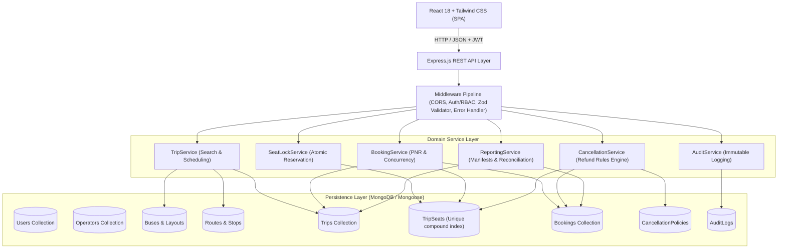
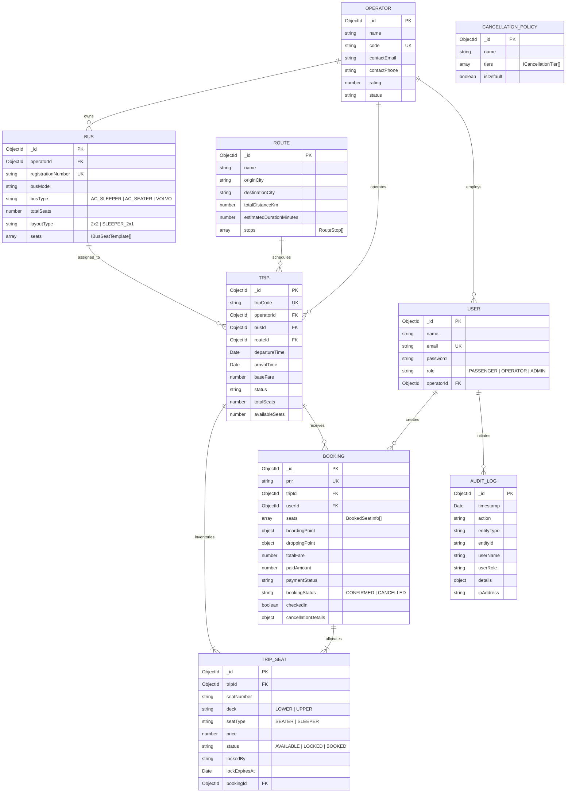

# OmniBus: Technical Report & Architecture Design Document

**Project**: Enterprise Bus Booking & Fleet Management Platform  
**Architecture**: MERN Layered Modular Monolith (MongoDB, Express, React, Node.js, Tailwind CSS)  
**Author**: Engineering Candidate  
**Date**: November 2026  

---

## 1. Executive Summary & Business Architecture
The intercity bus transportation sector operates under demanding real-time conditions: high concurrency during peak booking windows, variable seat layouts across operators (2+2 seaters, 2+1 luxury sleeper berths), strict regulatory manifest compliance, and dynamic cancellation policies.

This system provides a full-stack, enterprise-grade solution that satisfies all five core acceptance criteria:
1. **End-to-End Trip Discovery & Booking**: Real-time multi-operator search with 2D interactive seat layouts.
2. **ACID Seat Concurrency & Anti-Double-Booking**: Elimination of simultaneous booking collisions at the database layer.
3. **Verifiable PNR Integrity**: Cryptographic PNR token issuance containing route, timing, passenger, and seat data.
4. **Configurable Tiered Cancellation**: Dynamic refund calculation based on time remaining before departure.
5. **Operator Manifest & Occupancy Reconciliation**: 1:1 mathematical reconciliation of ticket inventories, boarding manifests, and real-time check-in tracking.

---

## 2. System Architecture & Separation of Concerns

The application adheres to a clean **Layered Modular Monolith** pattern:



---

## 3. Database Schema & Entity-Relationship (ER) Diagram



---

## 4. Key Engineering Decisions & Acceptance Criteria Defense

### 4.1 AC-2: Seat Integrity & Anti-Double-Booking Concurrency Strategy
*The Problem*: Two users concurrently viewing an available seat (e.g. seat "L5") submit booking confirmation requests at the exact same millisecond. Without strict concurrency guarantees, both bookings would be accepted, creating duplicate confirmed tickets for one seat.

*Our Solution*:
1. **Database-Level Compound Unique Index**:
   ```typescript
   TripSeatSchema.index({ tripId: 1, seatNumber: 1 }, { unique: true });
   ```
   No two records can ever exist for the same seat on any trip.
2. **Atomic Compare-And-Swap (CAS) State Transition**:
   ```typescript
   const seat = await TripSeat.findOneAndUpdate(
     {
       tripId: tripObjId,
       seatNumber: p.seatNumber,
       $or: [
         { status: 'AVAILABLE' },
         { lockedBy: userIdentifier },
         { status: 'LOCKED', lockExpiresAt: { $lt: now } }
       ]
     },
     {
       $set: {
         status: 'BOOKED',
         lockedBy: null,
         lockExpiresAt: null,
       }
     },
     { new: true }
   );
   ```
3. **Rollback & Conflict Propagation**:
   If `findOneAndUpdate` returns `null` for any seat in a multi-seat batch (because another request claimed it first), any previously acquired seats in the batch are immediately rolled back to `AVAILABLE`, and an HTTP `409 Conflict` error is returned with code `SEAT_ALREADY_BOOKED`.
4. **Automated Concurrency Test Evidence**:
   Verified via `concurrency.conflict.test.ts` where simultaneous requests (`Promise.all([resA, resB])`) confirm that exactly one request succeeds with `201` and the second is rejected with `409`.

---

### 4.2 AC-4: Dynamic Cancellation & Refund Calculation Engine
The system supports a configurable policy matrix evaluated at runtime:

$$\text{Remaining Hours} = \frac{\text{Departure Time} - \text{Current Time}}{3600 \times 1000}$$

$$\text{Refund Amount} = \text{round}\left( \frac{\text{Total Fare} \times \text{Refund Percentage}}{100} \right)$$

$$\text{Cancellation Fee} = \text{Total Fare} - \text{Refund Amount}$$

| Tier | Hours Remaining | Refund % | Cancellation Fee % | Outcome |
| :--- | :--- | :--- | :--- | :--- |
| **Tier 1 (Early)** | $\ge 24$ hours | $90\%$ | $10\%$ | $90\%$ returned, seat freed |
| **Tier 2 (Mid)** | $12 \le h < 24$ | $50\%$ | $50\%$ | $50\%$ returned, seat freed |
| **Tier 3 (Late)** | $0 \le h < 12$ | $0\%$ | $100\%$ | Non-refundable, seat freed |
| **Departed** | $< 0$ hours | N/A | N/A | **HTTP 400 Rejected** |

Upon cancellation:
1. `Booking.bookingStatus` transitions from `CONFIRMED` $\to$ `CANCELLED`.
2. `TripSeat.status` transitions from `BOOKED` $\to$ `AVAILABLE`, immediately releasing the seat for other passengers.
3. `Trip.availableSeats` increments atomically by the number of released seats.
4. Full historical record is preserved for the operator manifest and passenger history.
5. An immutable audit record is written to `AuditLog`.

---

### 4.3 AC-5: Operator Manifest & Mathematical Occupancy Reconciliation
The passenger manifest reconciles with confirmed tickets:

$$\text{Total Seats Offered} = \text{Confirmed Booked Seats} + \text{Remaining Available Seats}$$

$$\text{Occupancy Rate (\%)} = \text{round}\left( \frac{\text{Confirmed Seats}}{\text{Total Capacity}} \times 100 \right)$$

$$\text{Net Revenue} = \text{Gross Ticket Sales} - \text{Refunds Paid}$$

The operator manifest endpoint (`GET /api/reports/trips/:id/manifest`) flattens and sorts all confirmed and cancelled seats, tracks check-in state (`checkedIn: boolean`), and provides instant CSV export and printable formatting for bus boarding staff.

---

## 5. Security & Server-Side Authorization (RBAC)
Authentication is enforced using JSON Web Tokens (JWT) and Bcrypt (salt rounds = 10). Server-side authorization never relies on UI button visibility:
- **`authenticate`**: Verifies signature, validity, and expiration of JWT bearer token.
- **`authorize('ADMIN', 'OPERATOR')`**: Restricts sensitive administrative mutations (creating operators, registering buses, configuring cancellation tiers, accessing raw audit logs).
- **Zod Schema Validation**: Every API payload is validated before hitting controller logic, preventing prototype pollution and malformed inputs.

---

## 6. Zero-Friction Local Execution Design
To ensure reviewing engineers can run the project on any machine without needing pre-installed external database servers or Docker daemons:
- `db.ts` automatically attempts connecting to `process.env.MONGODB_URI` if provided.
- If no external URI is provided or connection fails, it transparently boots `mongodb-memory-server` in 1 second.
- Reviewer quick-role switch bar in the frontend allows instantaneous evaluation across Passenger, Operator, and Admin views with a single click.
